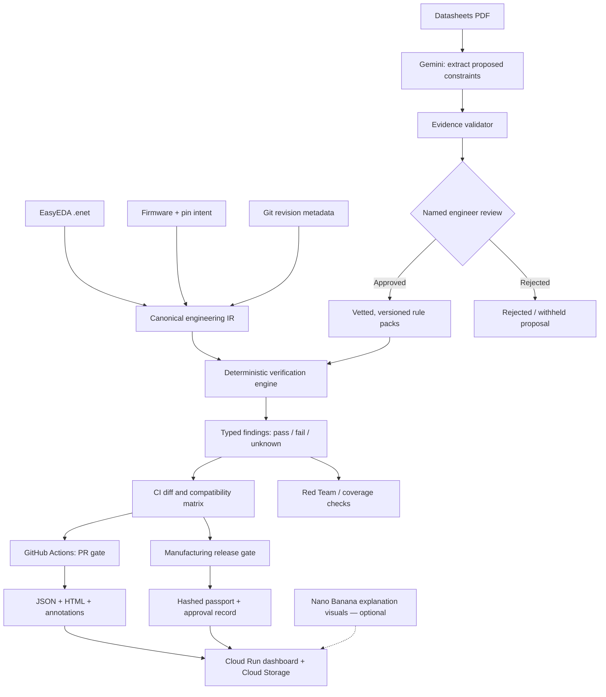

# BoardProof — Technical Architecture and Build Specification

**Edition:** v1.0 | **Date:** 16 November 2026  
**Product:** AI-assisted hardware verification and continuous integration  
**Team:** Bhuvan Prakash (team lead) and Prem Kumar  
**Purpose:** An implementation blueprint for the Google DeepMind × Google Cloud Startup Buildathon, 20–21 November 2026.

> Status matters. **Reported working MVP** below is based on the founder's account, not an independent inspection of the repository. **Proposed** sections are design specifications and must not be represented as shipping functionality.

## 0. The product in one paragraph

BoardProof connects electronic design artifacts that are normally reviewed separately: EasyEDA schematics/netlists, component datasheets, firmware configuration, and Git revisions. Gemini proposes machine-readable requirements from real datasheets, with evidence for human review. An offline, deterministic verification engine checks approved electrical and hardware–firmware contracts. CI evaluates each revision, identifies new regressions, and publishes reports. A stricter manufacturing-release gate maintains a record of outstanding issues, unverified areas, exceptions and engineer sign-off. BoardProof complements, rather than replaces, conventional ERC/DRC, physical simulation, and board-level qualification.

## 1. Architecture principles

1. **One canonical design model:** Import all supported source formats into stable typed components, pins, nets, signals, rules and revisions.
2. **The LLM has no veto or voting authority:** Gemini generates candidates and explanations; a validated, signed-off rule pack drives pass/fail.
3. **Unknown is not Pass:** Unsupported firmware expressions, ambiguous nets, unavailable data or missing reviewer approval become `UNKNOWN`/`BLOCKED` according to gate policy.
4. **Reproducibility:** Record source SHA-256 values, rule-pack hashes, checker version, policy version and configuration version for every run.
5. **Revision awareness:** PR checks primarily surface newly introduced findings; manufacturing release checks the full active set.
6. **Scope honesty:** The passport expressly lists tests not executed, e.g. RF, SI/PI, thermal, mechanical fit and footprint mapping unless validated.
7. **Local-first and low-cost:** Full deterministic checks run offline from a CLI; cloud features are an optional collaboration layer.
8. **No hidden design edits:** An engineer must approve changes; AI-generated patches are candidate diffs, never silent commits.

## 2. System architecture



**Trust boundary:** The extraction/AI lane never writes directly into the approved rules or into the verdict function. The engineering IR is derived from deterministic parsers; Gemini output remains proposed data.

## 3. Implementation modules

### 3.1 Source adapters

- `adapters/easyeda_pro.py`: Parse `.enet` files to normalized components, physical pin numbers and nets. Validate schema versions, file size, uniqueness and malformed records. Do not infer unknown footprint-pad mappings from a netlist.
- `adapters/firmware.py`: Supported-subset parser for numeric `#define`, `const/constexpr`, `Wire.begin(sda,scl)` and explicit GPIO mappings, with clearly documented syntax. Unsupported macro arithmetic and dynamic pin choices become `FW_UNKNOWN`.
- `adapters/datasheet.py`: PDF source hash, page indexing and retained page context for the candidate-extraction process.
- `adapters/github.py`: Compare `base` and `head` revision manifests and report stable finding IDs.

### 3.2 Canonical Engineering IR

- `Component`: reference (`U1`), manufacturer, MPN, package, source component ID.
- `Pin`: component reference, **physical** pin number, optional pin label, actual net ID.
- `Net`: net ID, normalized name, declared/verified voltage domain and all connected endpoints.
- `FirmwareSignal`: intended function (`I2C_SDA`), compiled or statically resolved pin, source file and line, targeted board/MCU variant.
- `HardwareIntent`: named signal, expected MCU physical pad/GPIO, target net, supported firmware version or configuration.
- `Rule`: predicate, units, applicability, component target and source evidence; status is `PROPOSED`, `REJECTED`, or `VETTED`.
- `Finding`: stable ID, severity, result, exact source locations, observed value, required value, rule/evidence ID and suggested investigation.
- `RevisionManifest`: git SHA, source file hashes, approved rule-pack hashes, policy hash, checker version, test scope and timestamps.

Net names are not sufficient evidence of electrical correctness. Always follow actual physical connections and validated MCU pin mappings.

### 3.3 Gemini evidence-to-rule compiler

1. Upload original PDF; compute SHA-256 and record manufacturer/revision.
2. Ask Gemini for typed **candidate** constraints: part, pin, physical quantity, units, range/comparator, conditions, source page/section and verbatim excerpt.
3. Validate schema and units; reject unsupported types, missing or ambiguous sources and ranges outside the PDF.
4. Verify the excerpt against page text and, for tables, its row/column context; a number merely occurring in a quote is insufficient to prove semantic support.
5. Present the original excerpt and candidate side by side for review.
6. Require a named reviewer to approve an immutable version of the rule pack.
7. CI consumes only approved packs, never draft proposals.

```json
{
  "schema_version": "1.0",
  "part": "TMP102",
  "manufacturer": "Texas Instruments",
  "datasheet_revision": "SBOS397I",
  "document_sha256": "<sha256-of-original-pdf>",
  "status": "proposed",
  "rules": [
    {
      "id": "tmp102-vplus-recommended-range",
      "kind": "voltage_range",
      "target": {"component": "U1", "pin_name": "V+"},
      "limits": {"min": 1.4, "max": 3.6, "unit": "V"},
      "condition": "recommended operating conditions",
      "evidence": {
        "page": 4,
        "section": "5.3",
        "exact_quote": "<verbatim-source-excerpt-to-review>"
      }
    }
  ]
}
```

The illustration above **must not** be promoted to a vetted pack until the exact quote, conditions, pin interpretation and reviewer are verified. Your reported TMP102 pack vetted GND/pull-ups, while Gemini's quoted supply-range proposal was withheld. The reported intentional 5V detection belongs to the approved fixture check; do not claim that the withheld Gemini voltage rule was somehow enforced.

### 3.4 Deterministic rule engine

Initial supported predicates:

| Predicate | Meaning | Outcome when evidence is missing |
|---|---|---|
| `pin_net` | Physical pin must connect to an approved net | `UNKNOWN` or `FAIL` per policy |
| `pin_connected` | Required pin must have a valid connection | `FAIL` |
| `voltage_range` | The rated pin's known voltage is inside approved bounds | `UNKNOWN` |
| `resistor_between` | Approved resistor topology/value between named endpoints | `UNKNOWN` if value/topology missing |
| `firmware_gpio` | Explicitly approved firmware GPIO matches MCU pin/net contract | `UNKNOWN` if code is dynamic/ambiguous |
| `required_peripheral` | Required I²C/other peripheral signals match validated MCU mapping | `UNKNOWN` |

Engine signature (proposed):

```python
from dataclasses import dataclass

@dataclass(frozen=True)
class CheckResult:
    check_id: str
    status: str            # PASS | FAIL | UNKNOWN
    severity: str          # critical | major | warning
    evidence: tuple[str, ...]
    observed: str | None
    expected: str | None


def verify(design_ir, vetted_rules, hardware_intent, policy) -> list[CheckResult]:
    """Pure, deterministic; must not call Gemini or network APIs."""
    ...
```

Use `Decimal` or exact integer millivolts for voltage thresholds when possible, and explicit unit conversion. Do not compare floating-point quantities without tolerance rules. The type-specific semantics of resistors and rails must be documented.

### 3.5 CI and revision diff

- A PR runs the deterministic checker on `head` and compares against a pinned base revision, approved rules and policy.
- Give findings stable fingerprints based on rule ID, target component/pin and violated property, so line moves do not create false 'new' alerts.
- Classify `NEW`, `PERSISTING`, `RESOLVED` and `UNKNOWN`, and show both absolute and delta counts.
- PR gate policy: block new critical violations, revoked/changed unreviewed packs and missing checks designated mandatory for CI.
- **Manufacturing release**: block *all* unresolved critical violations and mandatory unknowns, even if the problems predate the latest PR. Exceptions require a recorded accountable reviewer and explicit scope.
- Do not allow renaming a net, disabling a test, or deleting a rule pack to turn a critical failed design silently green. Policy/rule changes require their own review.

Illustrative GitHub workflow (the exact repository paths and CLI options must be matched to the actual code):

```yaml
name: BoardProof CI
on:
  pull_request:
    paths:
      - 'hardware/**'
      - 'firmware/**'
      - 'packs/**'
      - 'boardproof.json'
      - '.github/workflows/boardproof.yml'
  workflow_dispatch:
permissions:
  contents: read
jobs:
  preflight:
    runs-on: ubuntu-latest
    steps:
      - uses: actions/checkout@v4
      - uses: actions/setup-python@v5
        with:
          python-version: '3.12'
      - name: Install BoardProof
        run: python -m pip install -e .
      - name: Run approved, offline checks
        run: boardproof check --config boardproof.json --explain --engine offline
```

GitHub-native `::error`/`::warning` annotations are the minimum integration. SARIF is optional and its availability varies by repository and GitHub Code Security entitlement.

### 3.6 Compatibility matrix

For each supported `(board_revision, firmware_build, MCU_variant)` triple:

- Compare reviewed hardware intent (signal, GPIO physical pin mapping) with statically verified firmware configuration.
- Return `COMPATIBLE_WITHIN_SCOPE`, `INCOMPATIBLE`, or `UNKNOWN`.
- Include the exact signal, net, firmware line and rule source when incompatible.
- Do not infer full electrical or functional compatibility from GPIO equality alone.

### 3.7 Red Team and coverage

Red Team applies isolated, controlled mutations: wrong GPIO, overvoltage rail, missing pull-up, disconnected supply and incorrect required net. Report mutation identity, expected finding, actual finding and whether it was caught. Preserve original design immutably. Separate mutation score from blind accuracy on unseen real designs. The reported **8/8** is targeted mutation coverage, not evidence of 100% real-world detection.

### 3.8 Manufacturing Passport

Fields: source/revision digests, verified rules and checker version, passed/failed/unknown check list, red-team scope, explicitly excluded areas, named reviewer, review time, exceptions and report hash. Compute SHA-256 over canonical JSON. **A checksum is not a cryptographic signature or proof of author identity**; if signed provenance is promised later, use a real signing key and verification process.

## 4. Deployment architecture

**MVP** (minimal operational complexity):

```text
GitHub repo -> GitHub Actions -> BoardProof CLI (offline)
                                     | JSON/HTML artifacts
                                     v
Cloud Run service <--------> Cloud Storage (private project artifacts)
      |
      +--> Firestore (projects, revisions, reviews, object references)
      |
      +--> Gemini API / Vertex AI (datasheet extraction on explicit request)
```

- `Cloud Run service`: Existing containerized dashboard + authenticated read-only artifact API. HTTP server listens on `$PORT`; service should be stateless.
- `Cloud Storage`: Original PDFs, `.enet` files, vetted packs and report JSON/HTML by project/revision. Private buckets and restricted service accounts.
- `Firestore`: `projects`, `design_revisions`, `rule_packs`, `reviews`, `verification_runs`, `release_approvals` collections; index by project ID and creation time.
- `Cloud Run Jobs` **later**: On-demand heavier parsing/evaluation jobs, not mandatory for a fast CLI checker.
- `Cloud Build`: Container build/deploy pipeline, separately from GitHub's board verification workflow.
- `Nano Banana` **optional**: Illustrative troubleshooting graphics, visibly labelled generated, never used as board design source, topology truth or pass/fail evidence.

Important: Never send proprietary schematics, firmware or PDFs to external models without explicit customer consent and appropriate data-handling disclosure. Restrict upload sizes and PDF parsing resources.

## 5. API surface (proposed; not implemented)

```text
POST   /v1/projects                         create project
GET    /v1/projects/{project_id}            show project metadata
POST   /v1/projects/{id}/artifacts           request authenticated upload
POST   /v1/projects/{id}/rules/infer         start Gemini candidate extraction
POST   /v1/rule-packs/{pack_id}/reviews      approve/reject a reviewed version
POST   /v1/projects/{id}/checks              start new check, return run ID
GET    /v1/runs/{run_id}                     status and summary
GET    /v1/runs/{run_id}/findings            evidence-linked findings
GET    /v1/runs/{run_id}/passport            report with explicit scope
POST   /v1/projects/{id}/releases            run strict release gate
GET    /healthz                              health probe
```

Suggested stored run summary:

```json
{
  "run_id": "run_001",
  "schema_version": "1.0",
  "revision": "<git-sha>",
  "checker_version": "<semantic-version>",
  "rules_sha256": "<digest>",
  "input_sha256": "<digest>",
  "policy_sha256": "<digest>",
  "gate": "pull_request",
  "verdict": "BLOCKED",
  "passed": 5,
  "failed": 1,
  "unknown": 2,
  "scope": ["pin_net", "resistor_between", "firmware_gpio"],
  "not_verified": ["RF", "thermal", "mechanical", "full footprint mapping"]
}
```

## 6. Repository organization (incremental, not a mandatory rewrite)

```text
boardproof/
  pyproject.toml
  boardproof/
    cli.py
    adapters/
      easyeda_pro.py
      firmware.py
      datasheet.py
    ir/
      models.py
      normalize.py
    ai/
      gemini_extractor.py
      evidence_validator.py
    rules/
      schema.py
      approvals.py
      engine.py
    ci/
      diff.py
      compatibility.py
      github_annotations.py
    reports/
      html.py
      passport.py
    redteam/
      mutations.py
  examples/
    tmp102/
  packs/
    tmp102-drl.json
  tests/
    test_netlist_import.py
    test_real_datasheet.py
    test_hardware_contract.py
    test_ci_gates.py
    test_release_policy.py
    test_unknown_states.py
  docs/
    ARCHITECTURE.md
    DEMO_90S.md
    RULES_AND_EVIDENCE.md
  .github/workflows/
    boardproof.yml
```

**Keep your existing files and names unless there is a reason to migrate; this layout represents logical ownership.** Avoid destabilizing the tested core immediately before the event.

## 7. Security and trust boundary

- Treat PDFs, schematic text, GitHub PR content and model responses as untrusted input (including prompt injection instructions inside datasheets/comments).
- Parse into strict schema with file-size limits, recursion limits, path traversal protection, PDF decompression limits and process timeouts.
- Read-only repo tokens for PR checks; do not grant untrusted PR workflows cloud deployment permissions.
- For Google Cloud write access from trusted GitHub workflows, use GitHub OIDC/Workload Identity Federation, not long-lived service account JSON keys.
- Separate `viewer`, `reviewer`, and `release_approver` permissions. A rule author must not silently self-approve a sensitive policy change if separation of duties is required.
- Encrypt data in transit and at rest; use private Cloud Storage, signed URLs only for short-lived explicit access.
- Require source/artifact hashes and a reliable audit event for each approval, override and release.
- Use explicit model/provider data handling rules before customer data ingestion.

## 8. Acceptance tests before claiming readiness

| Test | Expected outcome |
|---|---|
| Approved 3.3V TMP102 fixture | Passes configured checks |
| Same fixture wired to 5V | Approved check fails with `U1` and pin/net evidence |
| Gemini rule cites unsupported number | Rule withheld, CI cannot ingest it |
| Firmware selects wrong GPIO | Contract failure on supported syntax |
| Dynamic/unresolved GPIO expression | `FW_UNKNOWN`; mandatory gates block if required |
| Netlist pin ID missing | Explicit `MISSING_PIN` failure/unknown; never inferred silently |
| Rule pack edited without approval | CI blocks/untrusted pack |
| Pre-existing critical failure, no new changes | PR delta may report old error; manufacturing release still blocks |
| Fault injection on controlled fixture | Expected report with original and mutated inputs hashed |
| Repeated identical offline run | Same findings and machine-readable report content (excluding explicitly nondeterministic metadata) |
| Real external board, held-out test | Publish precision/recall, false positives and unknown rate |

## 9. Two-person execution plan

**Bhuvan — Architecture and verification:** Maintain canonical IR, rule compiler, firmware contract checker, gate policies, security review, and critical regression tests. Lead technical demo and architecture explanation.

**Prem — Integration, product and validation:** Own import UX, dashboard and Cloud Run deployment, GitHub PR walkthrough, test fixture organization, documentation, customer interviews and demo fallback. Both review each other's changes.

If technical skill distribution differs, swap ownership by competency. Keep only one person approving critical rule changes after review.

### Before November 20–21

1. Validate **one authentic EasyEDA Pro `.enet`** from a non-synthetic project; record parser coverage and limitations.
2. Create **one hardware–firmware contract** with one passing and one failing GPIO configuration.
3. Run a **real GitHub PR** check red→green; capture the public or private screenshot and artifact.
4. Finish **one reproducible live Gemini TMP102** citation example and one withheld-rule example.
5. Deploy **read-only dashboard** to Cloud Run (if time); use the local dashboard as fallback.
6. Obtain **one outside engineer's feedback**; avoid invented customer numbers.

### During the buildathon

- Day 1: Real input, CI integration, reliability improvements and mentor feedback.
- Day 2: Red→green live demonstration, evidence report, cloud dashboard, independent feedback and presentation rehearsal.
- Disclose what was built beforehand and follow organizer rules about pre-existing code.

## 10. Proposed subsequent releases

- **v0.2 — Revision-aware hardware contracts:** compatibility matrix, base/head comparison, unknown-handling test suite.
- **v0.3 — Manufacturing release management:** reviewer roles, mandatory checks, recorded exceptions, immutable evidence records.
- **v0.4 — Multi-EDA adapters:** KiCad and other netlists behind the same IR.
- **v0.5 — Design & Prove (experimental):** generate an **editable** PCB candidate from validated footprints/pad mappings, run EDA DRC and recompare connectivity; never claim automatic manufacturability.

## 11. Performance metrics

- Netlist parse latency p50/p95 by component count and file size.
- Deterministic check latency p50/p95; exact checker version and machine specification.
- Coverage: checked, failed and unknown requirements per board.
- Independent precision/recall on previously unseen examples, separated from targeted mutation score.
- PR false-positive rate and median time to resolve a valid finding.
- Evidence validation rate: fraction of Gemini proposals correctly withheld/accepted after manual audit.
- Real user value: reported design errors found and review time saved, with case-level evidence.

## 12. Demo statement

> “This firmware compiles. But the revision changes its GPIO assignment, and the PCB expects a different physical connection. BoardProof catches the mismatch in CI. Gemini helps us understand the datasheet, but only approved engineering rules can block or pass a design. We fix the pin mapping, rerun the check, and the same revision now passes the rules we actually verified.”

---

### Authoritative engineering references

- EasyEDA Pro `.enet` format: https://github.com/easyeda/easyeda-netlist-format/blob/main/easyeda-pro-netlist-format-en.md
- EasyEDA Pro export guide: https://prodocs.easyeda.com/en/schematic/export-netlist/
- Gemini PDF processing: https://ai.google.dev/gemini-api/docs/document-processing
- Gemini structured output: https://ai.google.dev/gemini-api/docs/structured-output
- GitHub workflow annotations: https://docs.github.com/en/actions/reference/workflows-and-actions/workflow-commands
- Google Cloud Run services/jobs: https://docs.cloud.google.com/run/docs/resource-model
- Google Cloud Workload Identity Federation: https://docs.cloud.google.com/iam/docs/workload-identity-federation
